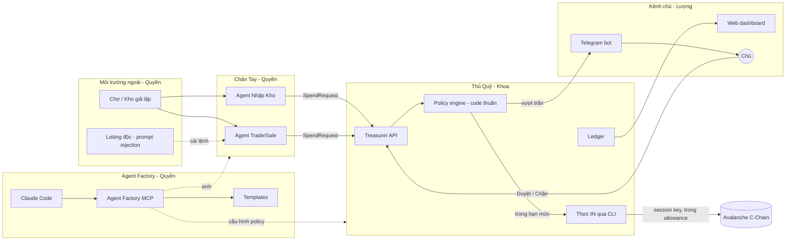

# 02. Kiến trúc

## Các khối và ai làm

## Luồng một yêu cầu chi

1. Chân Tay phát hiện cần mua, dựng `SpendRequest` (xem [03-hop-dong-chung.md](03-hop-dong-chung.md)) và gọi `POST /requests` của Thủ Quỹ bằng token của nó.
2. Thủ Quỹ validate schema bằng zod; sai schema thì trả `rejected` với `INVALID_REQUEST`.
3. Thủ Quỹ chạy `evaluate(request, policy, ledger)`, một hàm thuần không gọi LLM, không gọi mạng.
   Kết quả là `approved`, `pending_owner` hoặc `rejected`, kèm `reasonCode`.
4. `approved`: ghi ledger trước, rồi gọi CLI để chi (`send`, `x402-pay` hoặc `swap`), rồi cập nhật `executed` hoặc `failed` kèm tx hash.
5. `pending_owner`: lưu yêu cầu, phát sự kiện cho bot; chủ bấm Duyệt thì Thủ Quỹ làm bước 4; bấm Chặn hoặc quá 15 phút thì `rejected`.
6. `rejected`: không chi gì; nếu lý do là địa chỉ lạ thì báo chủ như một cảnh báo tấn công.

## Ranh giới tin cậy (trust boundary)

Đây là phần cả nhóm phải hiểu giống nhau, vì nó là lý do dự án tồn tại.

| Vùng | Tin được không | Hệ quả khi code |
|---|---|---|
| Dữ liệu chợ/kho, listing, email nhà cung cấp | Không | Chỉ Chân Tay đọc; coi là dữ liệu, không phải lệnh |
| Chân Tay (kể cả LLM của nó) | Không, coi như có thể đã bị hack | Không có khóa, không có token `/decide`, chỉ gửi được `SpendRequest` |
| Nội dung `SpendRequest` | Không | Thủ Quỹ chỉ xét các trường số và địa chỉ; `reason` chỉ hiển thị |
| Policy engine của Thủ Quỹ | Có | Code thuần, có unit test, không LLM |
| Allowance trên ví | Có, do ví thực thi | Lớp chặn cuối, kể cả khi Thủ Quỹ bị chiếm |
| Chủ (qua chat id Telegram / phiên web của chủ) | Có | Là nơi duy nhất mở được yêu cầu vượt trần |

Từ khóa nên biết: **trust boundary** (ranh giới tin cậy), **defense in depth** (phòng thủ nhiều lớp), **least privilege** (mỗi thành phần chỉ có đúng quyền nó cần).

Ba lớp phòng thủ, theo thứ tự: policy engine, rồi allowance của session key, rồi chủ duyệt.
Thiệt hại tối đa khi mọi thứ trong máy chủ bị chiếm vẫn bằng allowance còn lại.

## Tái sử dụng từ repo

| Cần | Có sẵn ở | Ghi chú |
|---|---|---|
| Khóa có hạn mức (Két sắt Bounded) | `packages/polygon-agent-cli/src/lib/session/` | `wallet login --allowance <usd> --days <n> --chains avalanche` |
| Token trên Avalanche | `src/lib/session/tokens.ts:81` | USDC, USDT trên 43114; Fuji 43113 chưa có |
| Chuyển token | lệnh `send` (`--to`, `--amount`, `--symbol`, `--chain`) | luôn kèm `--dry-run` hoặc `--broadcast` |
| Trả x402 | lệnh `x402-pay` (`--url`, `--max-usd`) | luôn kèm `--max-usd` |
| Swap DEX | lệnh `swap` (`--from`, `--to`, `--amount`), qua Trails | có Avalanche trong bảng chain |
| Mẫu luồng chủ duyệt | `src/lib/owner/`, `packages/agentconnect-ui/worker/money/actions.ts` | lưu 15 phút, đã quyết định thì không chạy lại |
| Mẫu "ghi trước khi gửi, không gửi lại" | `packages/agentconnect-ui/worker/money/engine.ts` | tham khảo cho ledger của Thủ Quỹ |

**Cách Thủ Quỹ gọi ví: chạy CLI như một tiến trình con, đọc JSON.**
CLI luôn in JSON (`{"ok": true, ...}` hoặc `{"ok": false, "error", "code", "hint"}`), nên đây là một ranh giới sạch.
Thủ Quỹ không import code nội bộ của CLI, nên nhóm không phải hiểu hết CLI và CLI vẫn cập nhật độc lập được.
Trong sơ đồ, "Avalanche CLI" chính là CLI này chạy với `--chain avalanche`.

## Package mới đề xuất

Workspace đã gom mọi thứ trong `packages/*`, nên thêm package nào cũng tự vào workspace.

| Package | Nội dung | Chủ |
|---|---|---|
| `packages/treasury-protocol` | Schema zod `SpendRequest`, `Decision`, `Policy`; stub server | Khoa |
| `packages/treasurer` | API, policy engine, ledger, thực thi qua CLI | Khoa |
| `packages/agent-factory` | MCP server, template, sinh dự án | Quyền |
| `packages/workers` | Agent Nhập Kho, agent Trade (LangGraph) | Quyền |
| `packages/mock-market` | API chợ/kho giả lập, listing độc | Quyền |
| `packages/owner-bot` | Telegram bot, báo cáo | Lượng |
| `packages/owner-dashboard` | Web dashboard tối giản | Lượng |

Tên package chốt ở buổi kickoff; quan trọng là mỗi package có một chủ.

## Công nghệ

| Phần | Đề xuất | Lý do |
|---|---|---|
| Ngôn ngữ | TypeScript, Node 24 | Cùng repo, cùng lint/test (`vitest`), dùng chung schema zod |
| Agent | LangGraph.js | Chung ngôn ngữ; nếu Quyền chỉ quen Python thì dùng Python, vẫn nói chuyện qua HTTP |
| LLM | Claude (`claude-sonnet-5-5` cho Chân Tay) | Chân Tay cần đọc hiểu listing; Thủ Quỹ không cần LLM để quyết định |
| Thủ Quỹ API | HTTP nhỏ (Hono hoặc `node:http`) | Đơn giản, chạy local |
| Lưu trữ | SQLite hoặc file JSONL | Đủ cho demo, ledger phải bền qua khởi động lại |
| Bot | Telegram Bot API (grammY hoặc telegraf) | Có nút inline cho Duyệt / Chặn |
| Chain | Avalanche C-Chain, có thể Fuji | Chốt sau spike A1 |

## Quyết định còn mở

1. LangGraph.js hay Python (Quyền chốt ở kickoff).
2. Avalanche mainnet số tiền nhỏ hay Fuji testnet (chờ spike A1).
3. Thể lệ BTC yêu cầu gì cụ thể về Avalanche (facilitator x402 nào, C-Chain hay L1 riêng): cả nhóm đọc lại thể lệ.
4. Tên dự án là White-label Agent Builder, nhưng package và lệnh CLI vẫn mang tên Polygon (`polygon-agent`): chốt đổi hẳn hay chỉ đổi tên hiển thị trong demo, để giám khảo không nhầm hệ sinh thái.
