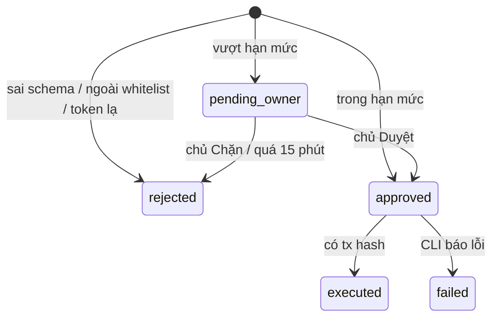

# 03. Hợp đồng chung giữa các khối

Đây là thứ duy nhất ba người phụ thuộc nhau.
Chốt nó ở kickoff, Khoa viết thành package `treasury-protocol` (task A2) kèm stub server.
Sau đó ai cũng code được phần của mình mà không chờ người khác.
Muốn đổi hợp đồng: mở PR sửa file này và package, cần cả hai người còn lại duyệt.

## SpendRequest (Chân Tay gửi Thủ Quỹ)

```ts
const SpendRequest = z.object({
  requestId: z.string().uuid(),         // Chân Tay tự sinh; gửi lại cùng id thì Thủ Quỹ trả kết quả cũ, không chi lần hai
  agentId: z.string(),                  // Chân Tay nào gửi, phải khớp token của nó
  kind: z.enum(['transfer', 'x402', 'swap']),
  chainId: z.union([z.literal(43114), z.literal(43113)]),
  token: z.string(),                    // địa chỉ token chi ra (0x...)
  amount: z.string().regex(/^\d+$/),    // số nguyên theo đơn vị nhỏ nhất (USDC 6 số lẻ: 20 USDC = "20000000")
  to: z.string(),                       // transfer: địa chỉ nhận; x402: URL dịch vụ; swap: địa chỉ token mua
  category: z.string(),                 // 'inventory' | 'trade' | 'service' ...
  reason: z.string().max(500),          // CHỈ để hiển thị cho chủ, không bao giờ ảnh hưởng quyết định
  createdAt: z.string().datetime()
});
```

Vì sao `amount` là chuỗi số nguyên: số thực JavaScript làm tròn sai với tiền (`0.1 + 0.2 !== 0.3`); dùng `BigInt` khi tính.

## Decision (Thủ Quỹ trả về)

```ts
const Decision = z.object({
  requestId: z.string().uuid(),
  status: z.enum(['approved', 'pending_owner', 'rejected', 'executed', 'failed']),
  reasonCode: z.enum([
    'OK',
    'INVALID_REQUEST',      // sai schema
    'UNKNOWN_AGENT',        // agentId không khớp token
    'NOT_WHITELISTED',      // địa chỉ / URL nhận không có trong whitelist
    'TOKEN_NOT_ALLOWED',
    'CHAIN_NOT_ALLOWED',
    'OVER_TX_LIMIT',        // vượt hạn mức một giao dịch -> pending_owner
    'OVER_DAILY_LIMIT',     // vượt hạn mức ngày -> pending_owner
    'OWNER_DECLINED',
    'OWNER_TIMEOUT',        // chủ không trả lời trong 15 phút
    'EXECUTION_FAILED'
  ]),
  txHash: z.string().optional(),
  updatedAt: z.string().datetime()
});
```

Vòng đời trạng thái:



Quy tắc: địa chỉ ngoài whitelist luôn `rejected`, không bao giờ `pending_owner`.
Lý do: nếu địa chỉ lạ cũng hỏi chủ, kẻ tấn công chỉ cần spam yêu cầu cho tới khi chủ lỡ tay bấm Duyệt.
Chủ muốn thêm địa chỉ thì sửa whitelist trên dashboard, không duyệt từng yêu cầu.

## Policy (chủ đặt, Thủ Quỹ đọc)

```ts
const Policy = z.object({
  agents: z.record(z.string(), z.object({   // agentId -> luật riêng
    categories: z.array(z.string()),
    perTxLimit: z.string(),                 // đơn vị nhỏ nhất của token
    dailyLimit: z.string()
  })),
  allowedChains: z.array(z.number()),
  allowedTokens: z.array(z.string()),
  whitelist: z.array(z.object({
    kind: z.enum(['address', 'x402_url', 'swap_token']),
    value: z.string(),
    label: z.string()                       // "Nhà cung cấp A", hiện cho chủ
  }))
});
```

## API của Thủ Quỹ

| Method | Path | Ai gọi | Xác thực |
|---|---|---|---|
| `POST` | `/requests` | Chân Tay | `Authorization: Bearer <worker token>`, mỗi Chân Tay một token |
| `GET` | `/requests/:id` | Chân Tay, bot, dashboard | token của Chân Tay đó, hoặc token chủ |
| `GET` | `/requests?status=` | bot, dashboard | token chủ |
| `POST` | `/requests/:id/decide` body `{ "decision": "approve" \| "decline" }` | bot, dashboard | **chỉ token chủ** |
| `GET` / `PUT` | `/policy` | dashboard | token chủ |
| `GET` | `/summary?date=` | bot | token chủ: đã chi, allowance còn lại, số lần bị chặn |
| `GET` | `/events` (Server-Sent Events) | bot, dashboard | token chủ |

Token của Chân Tay không bao giờ gọi được `/decide` hay `/policy`; đó là phần **least privilege**.

## Sự kiện gửi cho kênh chủ

```ts
type TreasurerEvent =
  | { type: 'request.pending_owner'; request: SpendRequest; decision: Decision }
  | { type: 'request.rejected'; request: SpendRequest; decision: Decision; suspicious: boolean } // suspicious = NOT_WHITELISTED
  | { type: 'request.executed'; request: SpendRequest; decision: Decision }
  | { type: 'request.failed'; request: SpendRequest; decision: Decision };
```

## Stub server (task A2)

Stub trả kết quả giả nhưng đúng schema, theo luật đơn giản:
`amount` dưới 50 USDC thì `executed` với tx hash giả, trên 50 thì `pending_owner`, `to` bắt đầu bằng `0xdead` thì `rejected` với `NOT_WHITELISTED`.
Nhờ vậy Quyền test được Chân Tay và Lượng test được bot ngay từ ngày đầu.
