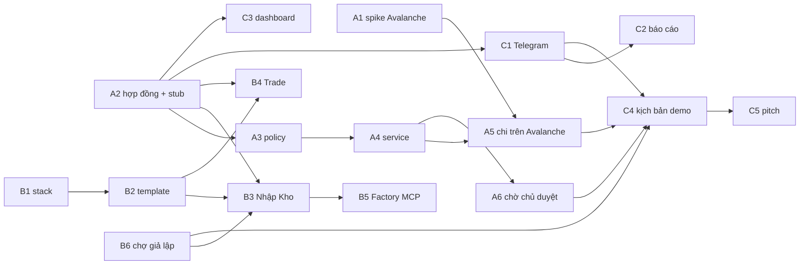

# White-label Agent Builder - tài liệu nhóm (UniHack)

Thư mục này dành cho ba thành viên trong nhóm.
Đọc theo thứ tự dưới đây; mất khoảng 30 phút.

| # | File | Đọc để biết |
|---|---|---|
| 1 | [01-tong-quan.md](01-tong-quan.md) | Dự án giải quyết vấn đề gì, ba tình huống demo, từ vựng chung |
| 2 | [02-kien-truc.md](02-kien-truc.md) | Các khối, luồng một yêu cầu chi, ranh giới tin cậy, phần tái sử dụng từ repo |
| 3 | [03-hop-dong-chung.md](03-hop-dong-chung.md) | Schema và API giữa các khối, thứ duy nhất ba người phụ thuộc nhau |
| 4 | [04-quy-uoc-lam-viec.md](04-quy-uoc-lam-viec.md) | Nhánh, commit, hook của repo, Definition of Done |
| 5 | File task của bạn, bên dưới | Việc của bạn, từng issue, khi nào là xong |

## Phân công

| Thành viên | Phụ trách | File task | Task |
|---|---|---|---|
| Quyền (chủ repo) | Agent Factory + Agent Chân Tay + chợ giả lập | [tasks/quyen-factory-chan-tay.md](tasks/quyen-factory-chan-tay.md) | B1-B6 |
| Khoa | Agent Thủ Quỹ + Két sắt Avalanche | [tasks/khoa-thu-quy.md](tasks/khoa-thu-quy.md) | A1-A6 |
| Lượng | Kênh báo Ông Chủ (Telegram, web) + demo + pitch | [tasks/luong-kenh-chu-demo.md](tasks/luong-kenh-chu-demo.md) | C1-C5 |

Mã task giữ theo khối: `A` là Thủ Quỹ, `B` là Factory và Chân Tay, `C` là kênh chủ và demo.

## Mốc

| Mốc | Nội dung | Task |
|---|---|---|
| M0 - Kickoff | Cả nhóm đọc xong tài liệu, chốt hợp đồng chung và các quyết định còn mở; spike Avalanche; stub server | A1, A2, B1 |
| M1 - Chạy riêng | Mỗi người chạy được phần mình với stub | A3, B2, B3, B6, C1 |
| M2 - Nối thật | Chân Tay gửi tới Thủ Quỹ thật, Thủ Quỹ chi thật trên Avalanche, bot nhận yêu cầu chờ duyệt | A4, A5, A6, B4, C2 |
| M3 - Đủ tính năng | Factory sinh cặp agent, kịch bản tấn công, dashboard | B5, C3, C4 |
| M4 - Đóng băng | Không thêm tính năng; tập demo, pitch, video | C5 |

Sau M0 không ai phải chờ ai, vì mọi người code theo cùng schema và cùng một stub server.

## Quyết định cần chốt ở kickoff

1. LangGraph.js hay Python cho Chân Tay (đề xuất LangGraph.js; xem [02-kien-truc.md](02-kien-truc.md)).
2. Avalanche mainnet số tiền nhỏ hay Fuji testnet (chờ kết quả A1).
3. Thể lệ BTC yêu cầu gì cụ thể về Avalanche: cả nhóm đọc lại thể lệ.
4. Tên dự án đã chốt là White-label Agent Builder; còn phải chốt có đổi tên package và lệnh CLI (`polygon-agent`) không, hay chỉ đổi tên hiển thị trong demo.
5. Username GitHub của từng người để gán issue.

## Từ tài liệu thành issue

Mỗi mục `A1`, `B3`, `C2`... trong file task là một issue: tiêu đề là dòng `###`, nội dung là phần bên dưới, label ghi sẵn.
Label cần tạo: `treasurer`, `worker`, `factory`, `owner-channel`, `demo`, `contract`, `security`, `avalanche`, `spike`, `blocker`, `setup`, `ui`, `docs`.
